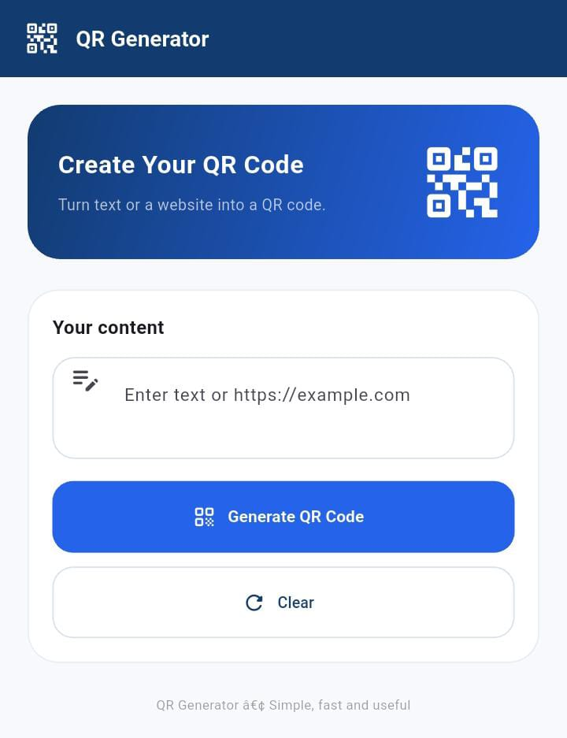

# QuickQR — QR Code Generator

<p align="center">
  A modern Flutter application for generating, previewing, saving, and sharing QR codes from text and URLs.
</p>

<p align="center">
  
  
  
  
  
  
</p>

---

## 📱 Preview

<p align="center">
  
</p>

## 📌 About

**QuickQR** is a Flutter mobile application developed as part of the Flutter Development Internship at **Auspify Technologies**.

The application lets users generate QR codes from text and URLs through a clean, user-friendly interface. It also provides options to save, share, and copy content, with recent QR entries retained for convenient access.

## ✨ Features

- **QR Code Generation** — Generate QR codes from text and supported URLs.
- **Input Validation** — Handle empty input and invalid HTTP/HTTPS URLs.
- **QR Preview** — View the generated QR code in the application.
- **Save QR Codes** — Save generated QR codes as image files.
- **Share QR Codes** — Share generated QR codes with other applications.
- **Copy Text** — Copy the entered content to the clipboard.
- **Recent History** — Keep recent QR entries using local storage.
- **Restore Previous Entries** — Select a history entry to reuse its content.
- **History Management** — Remove individual entries or clear the history.
- **Clear Input** — Reset the current input and generated result.
- **Responsive Interface** — Use a clean, blue-themed interface designed with Flutter widgets.

## 🛠️ Tech Stack

| Technology | Purpose |
|---|---|
| Flutter | Mobile application UI and development |
| Dart | Application programming language |
| `qr_flutter` | QR code rendering |
| `share_plus` | Sharing functionality |
| `flutter_file_saver` | File-saving functionality |
| `shared_preferences` | Local history persistence |
| `flutter_test` | Automated widget and application tests |

## 🚀 Getting Started

### Prerequisites

Install Flutter and the required Android development tools. Verify your environment:

```bash
flutter doctor
```

### Installation

Clone the repository:

```bash
git clone YOUR_GITHUB_REPOSITORY_URL
```

Navigate to the project directory:

```bash
cd qr_code_generator
```

Install dependencies:

```bash
flutter pub get
```

Run the application on a connected Android device or configured emulator:

```bash
flutter run
```

> Replace `YOUR_GITHUB_REPOSITORY_URL` with the actual repository URL after publishing the project.

## 📦 Build a Release APK

Create a release APK using:

```bash
flutter build apk --release
```

The generated APK will be available at:

```text
build/app/outputs/flutter-apk/app-release.apk
```

## 🧪 Testing and Verification

The project was verified with the following commands:

```bash
flutter test --reporter expanded
flutter analyze
flutter build apk --release
```

**Verification results:**

- All 15 automated tests passed.
- Flutter static analysis completed with no issues.
- Release APK build completed successfully.
- The main application features were manually tested on an Android phone.

## 📂 Project Structure

```text
qr_code_generator/
├── assets/
├── docs/
├── lib/
│   ├── main.dart
│   └── app_theme.dart
├── screenshots/
│   └── quickqr-preview.jpeg
├── test/
├── android/
├── ios/
├── web/
├── pubspec.yaml
├── pubspec.lock
└── README.md
```

## 🔮 Possible Future Improvements

- Add more QR code customization options.
- Support additional QR code content types.
- Improve export options and user preferences.
- Add further automated tests as the application evolves.

## 🎓 Internship Project

Developed as a practical project for the **Flutter Development Internship at Auspify Technologies**, with a focus on Flutter UI development, validation, package integration, local persistence, and testing.

## 📄 License

No open-source license has been specified for this project. Please contact the author before reusing or distributing the source code.

---

<p align="center">
  Built with Flutter 💙
</p>